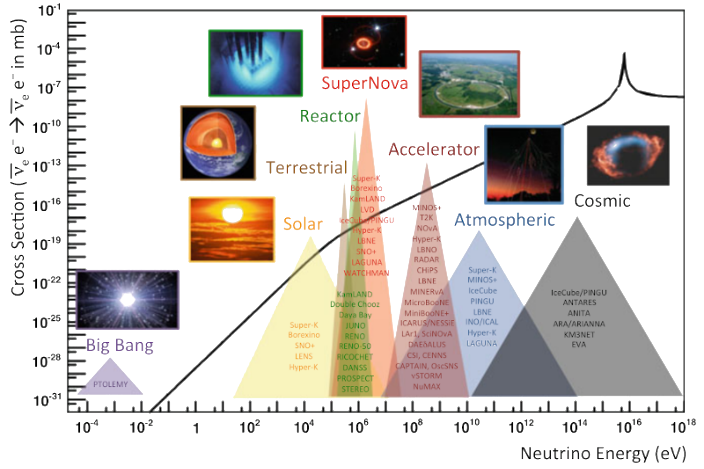
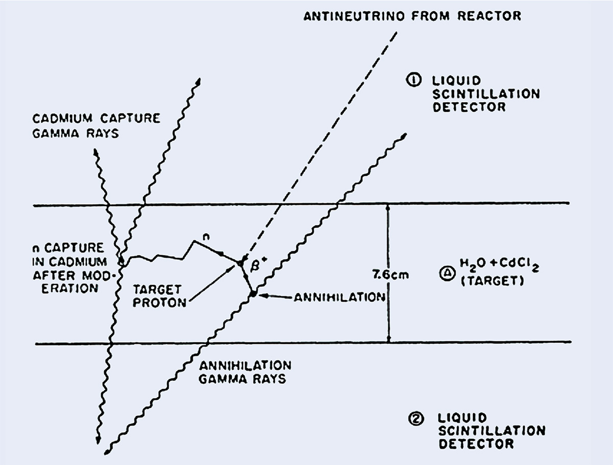
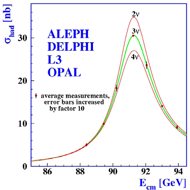

# Fundamental Neutrino Physics and Introduction

*Based on MPS 137: Frontiers of Physics – Part 1 (University of Sheffield)*

## 1. The Standard Model and Where Neutrinos Fit In

The **Standard Model (SM) of Particle Physics** is the theoretical framework describing all known fundamental matter and three of the four fundamental forces: electromagnetism, the weak interaction, and the strong interaction (excluding gravity).

<table style="text-align: center; margin-left: auto; margin-right: auto; width: 100%; border-collapse: collapse;">
  <thead>
    <tr style="border-bottom: 2px solid #ccc;">
      <th colspan="5" style="text-align: center; padding: 8px;">Fermions (Spin 1/2)</th>
    </tr>
    <tr style="border-bottom: 1px solid #ddd;">
      <th style="text-align: center; padding: 8px;"></th>
      <th colspan="2" style="text-align: center; padding: 8px;">Quarks</th>
      <th colspan="2" style="text-align: center; padding: 8px;">Leptons</th>
    </tr>
    <tr style="border-bottom: 1px solid #ddd;">
      <th style="text-align: center; padding: 8px;"></th>
      <th colspan="2" style="text-align: center; padding: 8px;">(Feel Weak, EM, &amp; Strong Force)</th>
      <th colspan="2" style="text-align: center; padding: 8px;">(Do NOT feel Strong Force)</th>
    </tr>
    <tr style="border-bottom: 2px solid #ccc;">
      <th style="text-align: center; padding: 8px;"></th>
      <th style="text-align: center; padding: 8px;"></th>
      <th style="text-align: center; padding: 8px;"></th>
      <th style="text-align: center; padding: 8px;">Charged Leptons (-1e)</th>
      <th style="text-align: center; padding: 8px;">Neutrinos (0 Charge)</th>
    </tr>
  </thead>
  <tbody>
    <tr style="border-bottom: 1px solid #eee;">
      <td style="text-align: center; padding: 8px;">Gen 1</td>
      <td style="text-align: center; padding: 8px;">Up, 2.16 MeV</td>
      <td style="text-align: center; padding: 8px;">Down, 4.67 MeV</td>
      <td style="text-align: center; padding: 8px;">Electron, 0.511 MeV</td>
      <td style="text-align: center; padding: 8px;">Electron Neutrino</td>
    </tr>
    <tr style="border-bottom: 1px solid #eee;">
      <td style="text-align: center; padding: 8px;">Gen 2</td>
      <td style="text-align: center; padding: 8px;">Charm, 1.27 GeV</td>
      <td style="text-align: center; padding: 8px;">Strange, 93.4 MeV</td>
      <td style="text-align: center; padding: 8px;">Muon, 105.7 MeV</td>
      <td style="text-align: center; padding: 8px;">Muon Neutrino</td>
    </tr>
    <tr style="border-bottom: 2px solid #ccc;">
      <td style="text-align: center; padding: 8px;">Gen 3</td>
      <td style="text-align: center; padding: 8px;">Top, 172 GeV</td>
      <td style="text-align: center; padding: 8px;">Bottom, 4.18 GeV</td>
      <td style="text-align: center; padding: 8px;">Tau, 1.777 GeV</td>
      <td style="text-align: center; padding: 8px;">Tau Neutrino</td>
    </tr>
    <tr style="border-bottom: 2px solid #ccc; background-color: rgba(0,0,0,0.02);">
      <td colspan="5" style="text-align: center; padding: 8px; font-weight: bold;">Bosons (Spin 0,1)</td>
    </tr>
    <tr style="border-bottom: 1px solid #ddd;">
      <td style="text-align: center; padding: 8px;"></td>
      <td colspan="2" style="text-align: center; padding: 8px; font-weight: bold;">Vector Bosons (Spin 1)</td>
      <td colspan="2" style="text-align: center; padding: 8px; font-weight: bold;">Scalar Boson (Spin 0)</td>
    </tr>
    <tr>
      <td style="text-align: center; padding: 8px;"></td>
      <td colspan="2" style="text-align: center; padding: 8px;">Gluon (Strong), Photon (EM), W/Z (Weak Force)</td>
      <td colspan="2" style="text-align: center; padding: 8px;">Higgs Boson (Mass generation)</td>
    </tr>
  </tbody>
</table>

### Lepton Family & Neutrino Properties

Neutrinos ($\nu_e, \nu_\mu, \nu_\tau$) are neutral leptons ($Q=0, C=0$) with spin $1/2$. Because they carry no electric or color charge:

* They **do not feel the strong force** or electromagnetism.
* They interact **strictly via the weak nuclear force** (mediated by W+ and $Z^0$ gauge bosons) and gravity.
* In the classical (massless) Standard Model, neutrinos were assumed to be strictly left-handed ($\nu_L$) and antineutrinos right-handed ($\bar{\nu}_R$).

## 2. Neutrino Sources and Production Mechanisms in Nature

Neutrinos are produced by many different elements of nature, including nuclear reactions, particle decays, and astrophysical processes across the history of the universe. 
We've also established methods of producing them ourselves. 
Below is a brief overview of some of the production mechanisms and sources.

1. **The Big Bang:** Relic neutrinos from cosmic decoupling ($\sim 1\text{ s}$ after the Big Bang) forming the Cosmic Neutrino Background (CNB) with density $\sim 336 \text{ cm}^{-3}$ at $T_\nu \approx 1.95 \text{ K}$.
2. **Solar Neutrinos:** Fusion reactions in the Sun's core ($p + p \rightarrow {}^2\text{H} + e^+ + \nu_e$).
3. **Supernovae:** Core-collapse events release $\sim 99\%$ of their gravitational binding energy as a burst of all neutrino flavours ($\nu_e, \nu_\mu, \nu_\tau$ and their antiparticles).
4. **Atmospheric Neutrinos:** Primary cosmic rays strike air molecules in Earth's atmosphere, creating hadronic cascades:

   $$
   \pi^\pm \rightarrow \mu^\pm + \nu_\mu (\bar{\nu}_\mu), \quad \mu^\pm \rightarrow e^\pm + \nu_e (\bar{\nu}_e) + \bar{\nu}_\mu (\nu_\mu)
   $$

5. **Nuclear Reactors:** Beta decay of neutron-rich fission fragments emits intense isotropic fluxes of $\bar{\nu}_e$.
6. **Accelerators:** High-energy proton beams target stationary nuclei (e.g., beryllium or carbon) to generate focused pion/kaon decay channels.
7. **Terrestrial & Biological:** Beta decay of ${}^{40}\text{K}$ in everyday objects (e.g., bananas emit $\sim 5,000 \text{ antineutrinos/second}$).

## 3. Neutrino Energies, Cross-Sections, and Experimental Design Implications

### Energy Spectrum vs. Cross-Section

Neutrinos cover over 18 orders of magnitude in energy. The neutrino-nucleon cross-section $\sigma$ scales directly with energy:

* **Low Energy (**$E_\nu \sim 1 \text{ MeV}$**):** Quasi-elastic / Inverse Beta Decay ($\sigma \sim 10^{-44} \text{ cm}^2$).
* **High Energy (**$E_\nu > 10 \text{ GeV}$**):** Deep Inelastic Scattering ($\sigma \propto G_F^2 E_\nu$).

### The Elusive Nature of Neutrinos

Because $\sigma \sim 10^{-44} \text{ cm}^2$ at solar energies:

$$
\text{Mean Free Path } \lambda = \frac{1}{n \cdot \sigma} \approx 6 \times 10^{12} \text{ miles } (\sim 1 \text{ light-year of solid lead})
$$

To stop just half of incoming solar neutrinos requires $\sim 6 \text{ trillion miles}$ ($1 \text{ light-year}$) of lead shielding.

Despite this, **flux is immense**: $\sim 100 \text{ billion } (10^{11})$ solar neutrinos pass through a human thumb every single second.

### Experimental Design Principles

To detect neutrinos efficiently given their tiny cross-section, experiments must satisfy:

1. **Enormous Mass (Volume):** Kilotons to Megatons of active target material.
2. **Background Reduction:** Deep underground installation (under thousands of meters of water equivalent, m.w.e.) to block cosmic ray muons.
3. **High-Intensity Sources:** Placing detectors near megawatt accelerators or multi-gigawatt nuclear reactors.

| Experiment       | Target Volume / Mass  | Detection Technology             |
|:---|:---|:---|
| Super-Kamiokande | 50 kt (Water)         | Water Cherenkov (11,146 PMTs)    |
| Hyper-Kamiokande | 260 kt (Water)        | Next-gen Water Cherenkov         |
| JUNO             | 20 kt (Scintillator)  | Liquid Scintillator              |
| DUNE             | 40 kt (Liquid Argon)  | Liquid Argon TPC (LArTPC)        |

## 4. History of Discovery: The Three Active Flavours

| | Historical discovery timeline|
|:---|:---|
|1930 | Pauli proposes "neutrino" to preserve energy conservation in β-decay
|1956 | Cowan & Reines discover ν_e (Reactor Inverse Beta Decay) [^1]
|1962 |Lederman, Schwartz, & Steinberger discover ν_μ (AGS Accelerator Beam) [^2]
|1989 |LEP Z⁰ width measurements prove N_ν = 2.984 ± 0.008 [^3]
|2000 |DONUT Collaboration directly observes ν_τ (Fermilab Tevatron) [^4]

### 1. Proposal and Discovery of Electron Neutrino ($\nu_e$)

* **Problem (1930):** Beta decay at rest ($\text{X}_A \rightarrow \text{X}_B + e^-$) produced a continuous electron energy spectrum instead of a discrete peak, seemingly violating energy/momentum conservation.
* **Pauli's Hypothesis:** Proposed a neutral, light spin-$1/2$ particle emitted alongside the electron which could not have been detected.
* **Discovery (1956):** Cowan and Reines detected $\bar{\nu}_e$ at the Savannah River reactor using Inverse Beta Decay (IBD) [^1].

  $$
  \bar{\nu}_e + p \rightarrow e^+ + n
  $$

  * Signature: Prompt $e^+e^-$ annihilation ($2 \times 511 \text{ keV} \, \gamma$-rays) followed $\sim 5 \, \mu\text{s}$ later by a delayed $\gamma$-ray cascade from neutron capture on Cadmium.

### 2. Proposal and Discovery of Muon Neutrino ($\nu_\mu$)

Once the muon had been discovered, and the existence of an associated neutrino was determined, the question of whether or not that neutrino was the same as the one associated with the electron became pertinent. 

* **Puzzle:** The decay $\mu \rightarrow e + \gamma$ was never observed, suggesting $\nu_\mu \neq \nu_e$.
* **Discovery (1962):** Lederman, Schwartz, and Steinberger used the Brookhaven AGS accelerator [^2].

  1. $15 \text{ GeV}$ protons struck a Be target to produce $\pi^\pm$.
  2. Pions decayed in flight: $\pi^+ \rightarrow \mu^+ + \nu_\mu$.
  3. A $13.5 \text{ m}$ steel shield stopped all charged particles ($\mu, \pi$).
  4. The purified neutrino beam hit a 10-ton spark chamber, producing **only muons** ($\nu_\mu + n \rightarrow \mu^- + p$) and **zero electrons**, proving $\nu_\mu$ is a distinct flavour.

### 3. Proposal and Discovery of Tau Neutrino ($\nu_\tau$)

* **Prediction (1975):** Followed Martin Perl's discovery of the $\tau$ lepton at SLAC.
* **Challenge:** Tau neutrinos cannot be produced in pion decay due to mass thresholds; they require decay of heavy charmed mesons ($D_s \rightarrow \tau + \nu_\tau$), demanding $800 \text{ GeV}$ protons.
* **Discovery (2000):** The **DONUT** collaboration at Fermilab observed $\nu_\tau + N \rightarrow \tau^- + X$ using high-resolution nuclear emulsion plates to resolve the characteristic "kinked" decay track of the short-lived $\tau$ lepton ($\tau \sim 1 \text{ mm}$) [^4].

## 5. Constraint on Active Neutrino Flavours: LEP $Z^0$ Width Limit

At CERN's Large Electron-Positron Collider (LEP), the combined ALEPH, DELPHI, L3, and OPAL collaborations measured the $Z^0$ resonance curve at $\sqrt{s} \approx 91.2 \text{ GeV}$ [^3].

The total decay width $\Gamma_Z$ is given by:

$$
\Gamma_Z = \Gamma_{\text{hadronic}} + 3\Gamma_{\text{charged leptons}} + N_\nu \Gamma_{\nu\bar{\nu}}
$$

Measuring the hadronic peak cross-section

$$
\sigma_{\text{hadronic}}^0 = \frac{12\pi}{M_Z^2} \frac{\Gamma_{ee} \Gamma_{\text{hadronic}}}{\Gamma_Z^2}
$$ 

yielded:

$$
N_\nu = 2.984 \pm 0.008
$$

This explicitly proved that **there are exactly three light active neutrino flavours** in nature.

# Summary of Confirmed Neutrino Properties (c. 2001)

By the turn of the 21st century, marked by the DONUT collaboration's direct observation of the tau neutrino in 2000[^4] and the definitive resolution of the solar and atmospheric neutrino anomalies by Super-Kamiokande and SNO[^5], experimental particle physics had established several foundational properties of neutrinos. 

* **Three Active Light Flavours:** Electroweak precision measurements of the $Z^0$ boson decay width at LEP confirmed the existence of exactly three light active neutrino flavours ($\nu_e$, $\nu_\mu$, and $\nu_\tau$) that participate in Standard Model weak interactions.[^3]
* **Flavour Mixing & Oscillations:** Neutrino flavour states ($\nu_e, \nu_\mu, \nu_\tau$) were proven to be quantum mechanical superpositions of mass states ($\nu_1, \nu_2, \nu_3$), described by the PMNS mixing matrix.[^6] As these mass states propagate through space with distinct phase velocities, neutrinos dynamically change flavour in transit.
* **Non-Zero Mass:** Because quantum oscillations fundamentally require non-zero mass-squared differences ($\Delta m_{ij}^2 \neq 0$), oscillation measurements provided the first conclusive proof that at least two neutrino mass eigenstates have non-zero rest masses, violating the original, strictly massless Standard Model formulation.[^7]

[^1]: Cowan, C. L., Reines, F., et al. (1956). "Detection of the Free Neutrino: a Confirmation". *Science*, 124(3212), 103–104.

[^2]: Danby, G., et al. (1962). "Observation of High-Energy Neutrino Reactions and the Existence of Two Kinds of Neutrinos". *Physical Review Letters*, 9(1), 36.

[^3]: ALEPH, DELPHI, L3, OPAL Collaborations, LEP Electroweak Working Group (2006). "Precision electroweak measurements on the $Z$ resonance". *Physics Reports*, 427(5–6), 257–454.

[^4]: Kodama, K., et al. (DONUT Collaboration) (2001). "Observation of tau neutrino interactions". *Physics Letters B*, 504(3), 218–224.

[^5]: Fukuda, Y., et al. (Super-Kamiokande Collaboration) (1998). "Evidence for Oscillation of Atmospheric Neutrinos". *Physical Review Letters*, 81(8), 1562–1567; Ahmad, Q. R., et al. (SNO Collaboration) (2001). "Measurement of the Rate of $\nu_e + d \to p + p + e^-$ Interactions Produced by $^8\text{B}$ Solar Neutrinos at the Sudbury Neutrino Observatory". *Physical Review Letters*, 87(7), 071301.

[^6]: Pontecorvo, B. (1957). "Inverse Beta Processes and Non-conservation of Lepton Charge". *JETP*, 7, 172; Maki, Z., Nakagawa, M., & Sakata, S. (1962). "Remarks on the Unified Model of Elementary Particles". *Progress of Theoretical Physics*, 28(5), 870–880.

[^7]: Goldhaber, M., Grodzins, L., & Sunyar, A. W. (1958). "Helicity of Neutrinos". *Physical Review*, 109(3), 1015–1017.