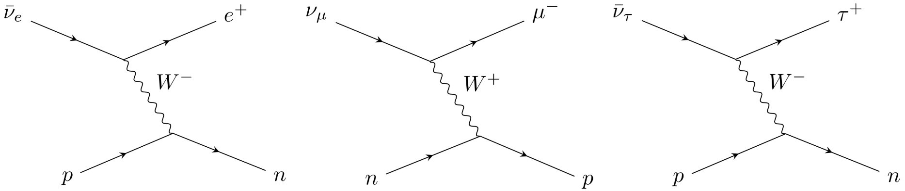
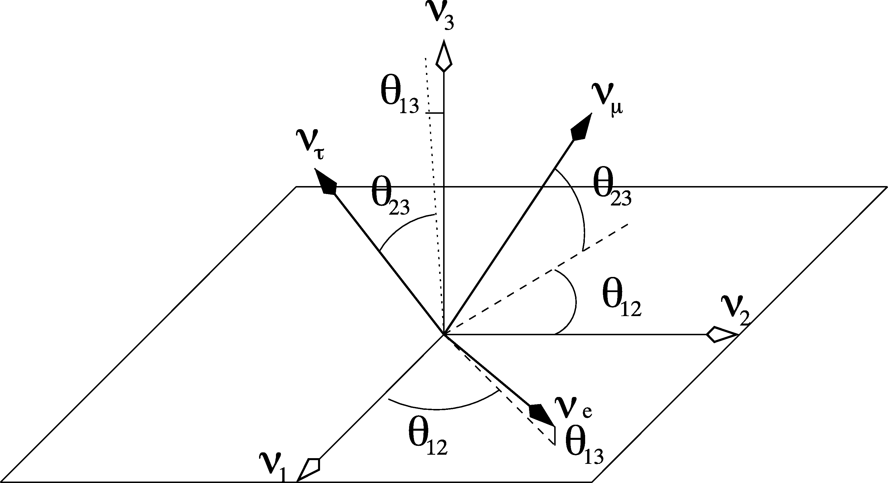
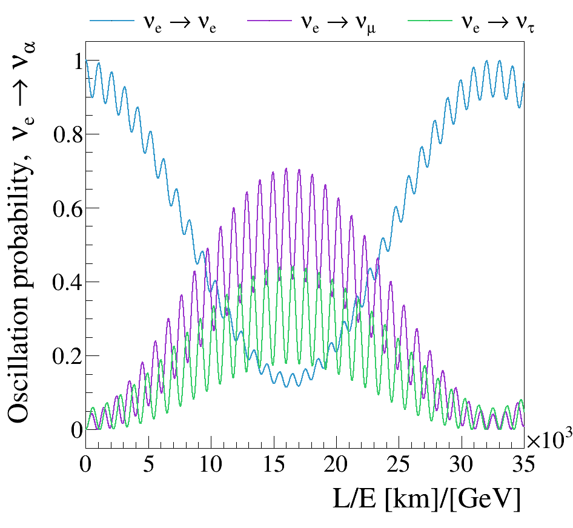
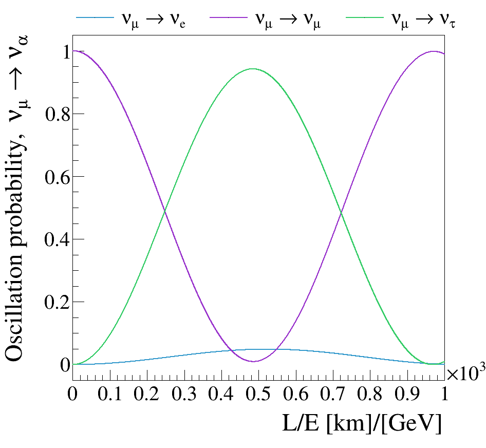

# Introduction to Neutrino Oscillations

## 1. Physics of Neutrino Oscillations

### Definition of terms: Eigenstates [Not Examinable]

In quantum mechanics, an **eigenstate** is a special state of a system in which measuring a specific physical property (called an **observable**, such as energy, momentum, or spin) will **always yield one single, completely definite result**.

When a system is in an eigenstate of a given measurement, there is no quantum uncertainty or randomness associated with that specific property. The single guaranteed result you measure is called the **eigenvalue**.

#### Physical Examples and Parallels

#### 1. The Musical Note Metaphor
Imagine listening to sound waves:
* **Superposition State:** A complex chord played on a guitar is a mix of many different frequencies at once. 
* **Eigenstate:** Striking a single tuning fork tuned to $440\text{ Hz}$ produces a pure, isolated tone. If you measure its frequency, you will get **$440\text{ Hz}$ every single time with 100% certainty**. 

In this analogy, the pure note is an eigenstate of frequency, and $440\text{ Hz}$ is its eigenvalue.

#### 2. Physical Example: Hydrogen Atom Energy Levels
Consider an electron bound within a hydrogen atom:
* The fixed electron orbits ($n = 1, 2, 3, \dots$) correspond to stationary quantum states.
* Each stationary state is an **energy eigenstate** (described by a wave function $\psi_n$).
* If an electron is in the ground state ($n = 1$), measuring its energy will **always** yield $-13.6\text{ eV}$. You will never get a random spread of values—the outcome is fixed because the electron is in a pure energy eigenstate.

#### 3. Application to Neutrinos: Flavour vs. Mass Eigenstates
In particle physics, eigenstates depend on **what** you are measuring:
* **Flavour Eigenstate ($\nu_e, \nu_\mu, \nu_\tau$):** An eigenstate of the weak interaction. If you measure how a neutrino interacts in a detector, it will produce **100% definitely** a specific charged lepton (electron, muon, or tau).
* **Mass Eigenstate ($\nu_1, \nu_2, \nu_3$):** An eigenstate of mass/energy. If you measure the mass of the state, it has **100% definitely** a single rest mass ($m_1, m_2,$ or $m_3$).

Because flavour eigenstates are not mass eigenstates, a neutrino produced with a definite flavour exists as a superposition of different mass eigenstates as it propagates through space.

### Flavour Identification vs. Mass Eigenstates

In detectors, we identify neutrino **flavour eigenstates** ($\vert{}\nu_e\rangle, \vert{}\nu_\mu\rangle, \vert{}\nu_\tau\rangle$) by the charged lepton produced at the weak interaction vertex ($W^\pm$ emission/absorption). 

For instance,

$$
\bar{\nu}_e + p \rightarrow e^+ + n, \\

\nu_\mu + n \rightarrow \mu^- + p,\\

\bar{\nu}_\tau + p \rightarrow \tau^+ + n.\\

$$

However, **flavour eigenstates are not mass eigenstates**. Neutrinos are produced and detected in flavour eigenstates, but propagate through space as **mass eigenstates** ($\vert{}\nu_1\rangle, \vert{}\nu_2\rangle, \vert{}\nu_3\rangle$).

### The PMNS Matrix Connection

The unitary **Pontecorvo-Maki-Nakagawa-Sakata (PMNS)** matrix $U$ rotates between bases [^1] [^2]:

$$
\vert{}\nu_\alpha\rangle = \sum_{k=1}^3 U_{\alpha k}^* \vert{}\nu_k\rangle \quad \Longleftrightarrow \quad \vert{}\nu_k\rangle = \sum_{\alpha} U_{\alpha k} \vert{}\nu_\alpha\rangle
$$

The standard parameterisation using three mixing angles ($\theta_{12}, \theta_{23}, \theta_{13}$) and one Dirac CP phase $\delta_{CP}$ is:

$$
U = \begin{pmatrix} 1 & 0 & 0 \\ 0 & c_{23} & s_{23} \\ 0 & -s_{23} & c_{23} \end{pmatrix} \begin{pmatrix} c_{13} & 0 & s_{13}e^{-i\delta_{CP}} \\ 0 & 1 & 0 \\ -s_{13}e^{i\delta_{CP}} & 0 & c_{13} \end{pmatrix} \begin{pmatrix} c_{12} & s_{12} & 0 \\ -s_{12} & c_{12} & 0 \\ 0 & 0 & 1 \end{pmatrix}
$$

(where $c_{ij} = \cos\theta_{ij}$ and $s_{ij} = \sin\theta_{ij}$)

This diagram visually illustrates the geometric relationship between **neutrino mass eigenstates** and **neutrino flavour eigenstates** in three-dimensional space using the PMNS (Pontecorvo-Maki-Nakagawa-Sakata) framework.

* **The Reference Frame ($\nu_1, \nu_2, \nu_3$):** 
  Represented by the open-arrow axes. These form an orthonormal coordinate system for the **mass eigenstates** (states of definite energy and propagation in space). Note that $\nu_1$ and $\nu_2$ define the horizontal plane, while $\nu_3$ points vertically.
* **The Rotated Basis ($\nu_e, \nu_\mu, \nu_\tau$):** 
  Represented by the solid-arrow vectors. These represent the **flavour eigenstates** (states produced and detected via the weak interaction). Because flavour states do not align with the mass axes, any single flavour state exists as a spatial projection (superposition) across all three mass states.

The transformation from the mass coordinate system ($\nu_1, \nu_2, \nu_3$) to the flavour coordinate system ($\nu_e, \nu_\mu, \nu_\tau$) is parameterized as a sequence of three spatial rotations through Euler-like angles:

1. **Solar Mixing Angle ($\theta_{12}$):** 
   Governs the rotation within the horizontal $(\nu_1 - \nu_2)$ plane, i.e. the mixing between the two lighter mass states ($\nu_1$ and $\nu_2$). It dictates solar neutrino oscillations ($p+p \to {}^2\text{H} + e^+ + \nu_e$).
2. **Atmospheric Mixing Angle ($\theta_{23}$):** 
   Governs the totation around the $\nu_1$ direction, tilting the vectors out of the plane toward the vertical $\nu_3$ axis. This constitutes the primary mixing between $\nu_\mu$ and $\nu_\tau$, driving atmospheric neutrino oscillations and long-baseline accelerator beam disappearance ($\nu_\mu \to \nu_\tau$).
3. **Reactor / Cross-Mixing Angle ($\theta_{13}$):** 
   Small tilt angle of $\nu_e$ relative to the $\nu_1-\nu_2$ plane (and correspondingly $\nu_3$ relative to the vertical axis) represents the small coupling between the electron flavour state ($\nu_e$) and the third mass eigenstate ($\nu_3$), measured by reactor experiments like Daya Bay and RENO.

Unlike the quark sector (CKM matrix), where mixing angles are very small and the bases almost align, the neutrino sector features **large mixing angles** ($\theta_{12} \approx 33.7^\circ, \theta_{23} \approx 49^\circ$), meaning the flavour vectors are tilted significantly relative to the mass axes. Only $\theta_{13} \approx 8.5^\circ$ is relatively small. Consequently, neutrino flavour oscillations are a substantial, measurable phenomenon across many sources of neutrinos.

#### Non-Trivial Mass Superposition

Because mixing angles are large ($\theta_{12} \approx 33.7^\circ, \theta_{23} \approx 49.1^\circ, \theta_{13} \approx 8.5^\circ$), individual flavour states are spread significantly across mass states. For instance, the muon neutrino state $\vert{}\nu_\mu\rangle = U_{\mu 1}^* \vert{}\nu_1\rangle + U_{\mu 2}^* \vert{}\nu_2\rangle + U_{\mu 3}^* \vert{}\nu_3\rangle$ has fractional contents:

$$
0.236 < \vert{}U_{\mu 1}^*\vert{} < 0.507, \quad 0.458 < \vert{}U_{\mu 2}^*\vert{} < 0.691, \quad 0.630 < \vert{}U_{\mu 3}^*\vert{} < 0.779
$$

Thus, there is no single "mass of a muon neutrino".

## 2. Quantum Mechanical Propagation and Probability

### Wavefunction Evolution in Space

Please refer to the slides with the wave cartoon to aid this explanation.

Each mass eigenstate $\vert{}\nu_k\rangle$ evolves as a plane wave:

$$
\vert{}\nu_k(x)\rangle = e^{-i \frac{m_k^2 x}{2E}} \vert{}\nu_k(0)\rangle
$$

Because the three neutrino mass eigenstates have different masses, $m_1 \neq m_2 \neq m_3$, their wavefunctions are out-of-phase. At different positions in space the linear superposition of mass states is different and the neutrino flavour eigenstate measured at different positions in space changes: Neutrino flavour oscillations occur!

### General Oscillation Probability Formula

The probability of a neutrino produced with flavour $\alpha$ being detected with flavour $\beta$ after baseline distance $L$ and energy $E$ is:

$$
P_{\alpha \rightarrow \beta}(L/E) = \sum_{k,j=1}^3 U_{\alpha k}^* U_{\beta k} U_{\alpha j} U_{\beta j}^* \exp\left( -i \frac{\Delta m_{kj}^2 L}{2E} \right)
$$

where $\Delta m_{kj}^2 \equiv m_k^2 - m_j^2$ known as the "mass-squared splitting".

## 3. Experimental Measurement Regimes and $L/E$ Optimization

To measure specific parameters ($\Delta m_{ij}^2, \theta_{ij}$), an experiment must match its baseline distance $L$ and energy $E$ to the scale of the mass splitting:

$$
\left\vert{} \Delta m^2 \right\vert{} \sim \frac{E}{L}
$$

extracted from the argument of the exponential in the oscillation probability equation.

| Experiment Type | Sources | L / E | Sensitive Parameters | Experiment examples |
| :--- | :--- | :--- | :--- | :--- |
| Short-Baseline (SBN) | Accelerator/Reactor | ~1 km/GeV | Searches for $\Delta m^2 \sim 1\text{ eV}^2$ | SBN Program |
| Long-Baseline (LBL) | Accelerator | ~$10^3\text{ km/GeV}$ | $\theta_{23}, \theta_{13}, \|\Delta m_{31}^2\|, \delta_{\text{CP}}$ | DUNE, T2K, Hyper-K, NO$\nu$A |
| Atmospheric | Cosmic Rays in Atmosphere | ~$10^2 - 10^4\text{ km/GeV}$ | $\theta_{23}, \|\Delta m_{31}^2\|$ | Super-K |
| Reactor & Solar | Reactors / Sun | ~$10^4 - 10^6\text{ km/GeV}$ | $\theta_{12}, \Delta m_{21}^2$ | JUNO/KamLAND |

### Probability Curves by Channel

Depending on initial flavour, probabilities show distinctive oscillation frequencies over a range of $L/E$:

These plots demonstrate how the above stated experimental design choices impact the mass-squared splitting parameter it will be sensitive to.

If the initial neutrino flavour is (anti-)electron and the L/E range spans many orders of magnitude, such as those produced by the sun or in a nuclear reactor, it is possible to measure the 'fast' mass splitting, $\Delta m_{21}^{2}$.

If the initial neutrino flavour is (anti-)muon, and the L/E range only extends to a few thousand km/GeV, such as in accelerator or atmospheric neutrino oscillation experimental setups, it is possible to measure the 'slow' mass splitting, $\Delta m_{3l}^{2}$.

## 4. Experimental Setups: Near/Far Detectors vs. Flux Modeling

### Two-Detector Setup (Accelerator Beams)

For artificial beams (e.g., DUNE, Hyper-K), experiments utilize a **Near Detector** and a **Far Detector**. At the long baseline, for instace,

* **Near Detector:** Positioned near the beam target ($L \sim \text{tens-hundreds of meters}$), before oscillations occur. The near detecotr therefore measures initial, unoscillated flux, flavour composition of the beam, and interaction cross-sections (predictions of which interactions will take place in the detector).
* **Far Detector:** Positioned hundreds of kilometers away ($L \sim 300\text{--}1300 \text{ km}$) at the predicted peak of the oscillation distance to measure flavour disappearance/appearance.

### Natural Source Setup (Solar & Atmospheric)

For natural sources (the Sun, atmospheric showers), placing a near detector at the source is impossible. Experiments rely on high-precision theoretical models of source flux (e.g., Bahcall's Standard Solar Model) and the known source-to-detector baseline ($L$).

## 5. Summary of Key Knowledge Confirmed by 20th Century Physics

By the end of the 20th century, neutrino experiments confirmed four fundamental pillars:

1. **Three Flavour Eigenstates:** $\nu_e, \nu_\mu, \nu_\tau$.
2. **Neutrino Oscillations:** Neutrinos change flavour as they travel.
3. **Non-Zero Neutrino Mass:** Oscillations require $\Delta m_{ij}^2 \neq 0$, proving at least two neutrino mass states are non-zero.

## 6. Open Questions at the End of the 20th Century

### Mass Generation Mechanism

Are neutrinos **Dirac** particles (mass from Higgs coupling) or **Majorana** particles (particles are their own antiparticles)? 
   
Does the Seesaw Mechanism explain why neutrino masses are so extraordinarily light ($\sim 10^6$ times lighter than electrons)?

### Neutrino Mass Ordering (Hierarchy)
   
Is the hierarchy **Normal** ($m_1 < m_2 < m_3$, $\Delta m_{31}^2 > 0$) or **Inverted** ($m_3 < m_1 < m_2$, $\Delta m_{31}^2 < 0$)?

### Leptonic CP Violation

Is the Dirac phase $\delta_{CP} \neq 0$? Can CP violation in the lepton sector explain the matter-antimatter asymmetry of the universe?

### Flavour Count

Are there additional non-interacting **sterile neutrinos** ($\nu_s$) suggested by short-baseline anomalies (LSND/MiniBooNE)?

---

## References

[^1]: Pontecorvo, B. (1957). "Inverse Beta Processes and Non-conservation of Lepton Charge". *JETP*, 7, 172.
[^2]: Maki, Z., Nakagawa, M., & Sakata, S. (1962). "Remarks on the Unified Model of Elementary Particles". *Progress of Theoretical Physics*, 28(5), 870–880.