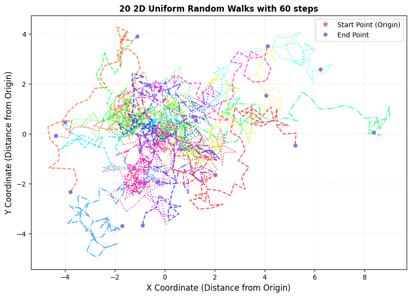
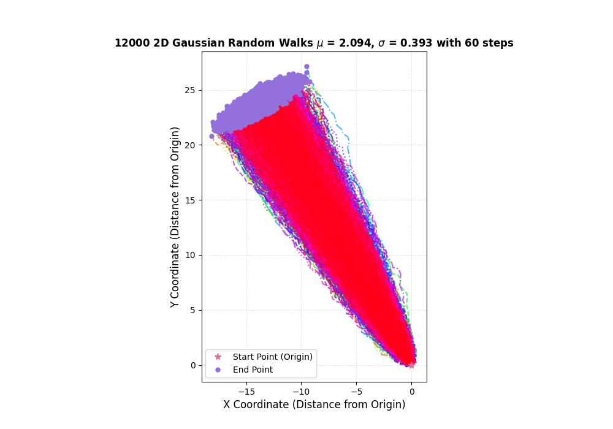
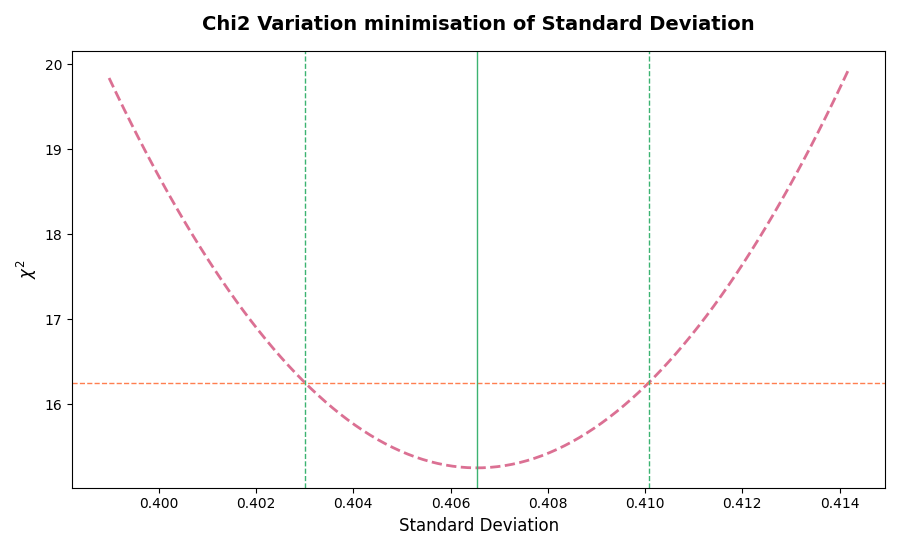
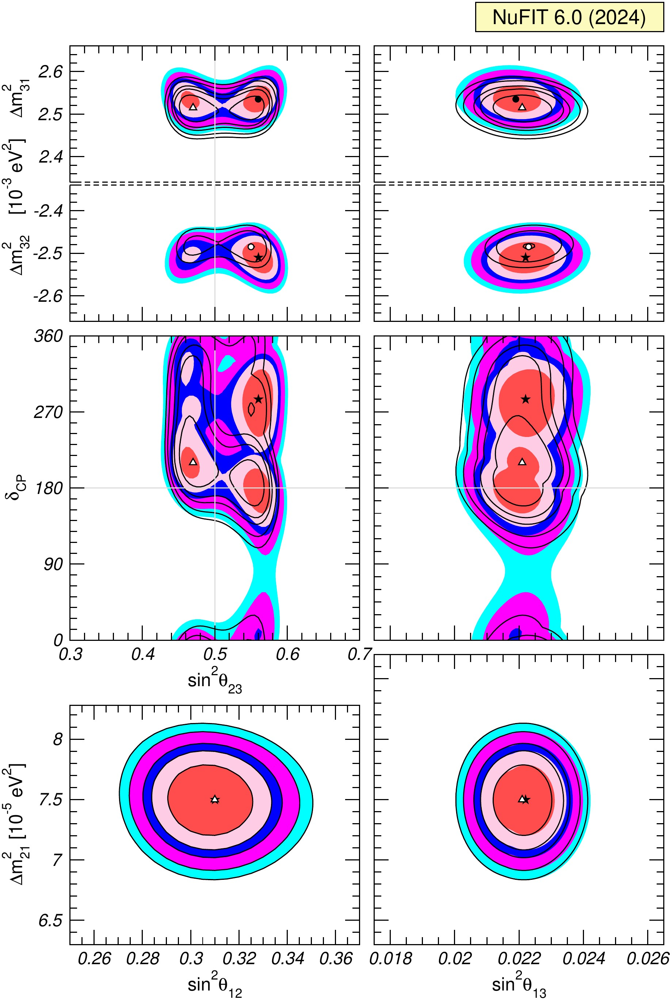

# Statistical Methods in Particle Data Analysis

## 1. Introduction

The primary goal of experimental particle physics is to validate theoretical predictions and test physical hypotheses in a fair, unbiased, and repeatable manner. Because fundamental interactions in quantum mechanics and particle physics are inherently probabilistic, direct predictions often cannot be made on an event-by-event basis. Instead, we predict **probability distributions** for observable quantities.

### Monte Carlo (MC) Simulations
Monte Carlo simulations[^1] are computational tools used to model theoretical predictions by generating synthetic pseudo-data through pseudo-random sampling. MC methods serve two distinct roles:
1. **Model Implementation:** Simulating physical processes using underlying theoretical models with tunable parameters to compare against experimental data.
2. **Framework Validation ("Fake Data" / Asimov Studies):** Testing the statistical robustness, bias, and sensitivity of an extraction method by attempting to measure known input parameters from synthetic datasets[^2].

---

## 2. Mathematical Foundations of Random Walks & Gaussian Models

To build intuition for complex multi-parameter data fits, we model particle trajectories as 2D random walks driven by underlying angular probability distributions. Also known as Monte Carlo simulations.

### Uniform vs. Dependent Step Random Walks
In a basic 2D uniform random walk, a particle starts at origin $(x_0, y_0) = (0,0)$. At each step $k \in \{1, \dots, N_{\text{steps}}\}$:
- Step length: $r$ (constant)
- Step angle: $\theta_k \sim U(0, 2\pi)$
- Position update:
  $$x_k = x_{k-1} + r \cos \theta_k, \quad y_k = y_{k-1} + r \sin \theta_k$$

When the physical system has directionality or prior constraints, $\theta_k$ is drawn from a non-uniform probability distribution, such as a Gaussian distribution.

### Mathematical Detail: 2D Gaussian Random Walk Kinematics

Let each step direction $\theta_k$ be an independent, random variable following a Normal distribution:

$$\theta_k \sim \mathcal{N}(\mu_\theta, \sigma_\theta^2)$$

#### Spatial Dispersion After $N$ Steps
For a small per-step angular variance $\sigma_\theta^2$, the particle tends to propagate along the mean vector direction $\vec{u} = (\cos\mu_\theta, \sin\mu_\theta)$.

Let the displacement vector along the path be $\vec{r}_k = r (\cos\theta_k, \sin\theta_k)$.
Using a Taylor expansion around $\mu_\theta$:
$$\cos\theta_k \approx \cos\mu_\theta - (\theta_k - \mu_\theta)\sin\mu_\theta$$
$$\sin\theta_k \approx \sin\mu_\theta + (\theta_k - \mu_\theta)\cos\mu_\theta$$

Summing over $N$ steps, the net end-point position $(X_N, Y_N)$ is given by:
$$X_N = \sum_{k=1}^N x_k \approx N r \cos\mu_\theta - r \sin\mu_\theta \sum_{k=1}^N (\theta_k - \mu_\theta)$$
$$Y_N = \sum_{k=1}^N y_k \approx N r \sin\mu_\theta + r \cos\mu_\theta \sum_{k=1}^N (\theta_k - \mu_\theta)$$

Let $S_N = \sum_{k=1}^N (\theta_k - \mu_\theta)$, which represents the **cumulative angular deviation**—the net sum of all individual step-by-step angular fluctuations away from the expected mean direction $\mu_\theta$ over the course of the $N$-step trajectory. 

By the **Central Limit Theorem (CLT)**, because $S_N$ is the sum of many independent, identically distributed random fluctuations, its probability distribution approaches a Gaussian centered at zero whose variance grows linearly with the number of steps:
$$S_N \sim \mathcal{N}(0, N \sigma_\theta^2)$$

#### Observed Angular Spread vs. Per-Step Variance

The final observed angle of the particle's displacement from the origin is:
$$\Theta_{\text{obs}} = \arctan\left(\frac{Y_N}{X_N}\right)$$

We are operating in the limit where the particle moves predominantly forward in a nearly straight path without curling back on itself, so its sideways drift is tiny compared to its total path length.

In this limit, the total distance, $R$, is linearly related to the step size, $r$, per $R \approx N r$, such that we can apply the small-angle approximation ($\arctan\epsilon \approx \epsilon$) to linearise the observed angle. Substituting the Taylor-expanded expressions for $X_N$ and $Y_N$ in terms of $S_N$:

$$\tan(\Theta_{\text{obs}}) = \frac{Y_N}{X_N} \approx \frac{N r \sin\mu_\theta + r S_N \cos\mu_\theta}{N r \cos\mu_\theta - r S_N \sin\mu_\theta}$$

Dividing numerator and denominator by $N r \cos\mu_\theta$:

$$\tan(\Theta_{\text{obs}}) \approx \frac{\tan\mu_\theta + \frac{S_N}{N}}{1 - \frac{S_N}{N}\tan\mu_\theta}$$

Using the tangent addition identity $\tan(A + B) = \frac{\tan A + \tan B}{1 - \tan A \tan B}$ with $A = \mu_\theta$ and $\tan B = \frac{S_N}{N}$:

$$\tan(\Theta_{\text{obs}}) \approx \tan\left(\mu_\theta + \arctan\left(\frac{S_N}{N}\right)\right) \implies \Theta_{\text{obs}} \approx \mu_\theta + \arctan\left(\frac{S_N}{N}\right)$$

Since the average angular deviation $\epsilon = \frac{S_N}{N}$ is small ($\epsilon \ll 1$), we apply the small-angle approximation $\arctan\epsilon \approx \epsilon$:

$$\Theta_{\text{obs}} \approx \mu_\theta + \frac{S_N}{N} = \mu_\theta + \frac{1}{N} \sum_{k=1}^N (\theta_k - \mu_\theta)$$

$$\Theta_{\text{obs}} \approx \mu_\theta + \frac{1}{N} \sum_{k=1}^N (\theta_k - \mu_\theta)$$

Thus, the expected value and variance of the observed angle $\Theta_{\text{obs}}$ are:
$$\mathbb{E}[\Theta_{\text{obs}}] = \mu_\theta$$
$$\text{Var}(\Theta_{\text{obs}}) = \sigma_{\text{obs}}^2 = \frac{\sigma_\theta^2}{N}$$
$$\sigma_{\text{obs}} = \frac{\sigma_\theta}{\sqrt{N}}$$

> **Key takeaway:** The observable dispersion $\sigma_{\text{obs}}$ shrinks as $1/\sqrt{N_{\text{steps}}}$. Therefore, measuring $\sigma_{\text{obs}}$ directly from end-points alone does **not** uniquely specify $\sigma_\theta$ unless $N_{\text{steps}}$ is known or fitted simultaneously.

---

## 3. Parameter Estimation & Goodness-of-Fit Metrics

### 3.1 Pearson's $\chi^2$ Test Statistic for Binned Data

When comparing binned data histograms against Monte Carlo predictions, we define the $\chi^2$ statistic across $K$ bins[^4]:

$$\chi^2 = \sum_{i=1}^K \frac{(O_i - E_i(\boldsymbol{\theta}))^2}{\sigma_i^2}$$

Where:
- $O_i$: Observed event count in bin $i$.
- $E_i(\boldsymbol{\theta})$: Expected event count predicted by the MC model for parameters $\boldsymbol{\theta}$.
- $\sigma_i$: Total standard uncertainty in bin $i$. Usually defined by the statistical and systematic uncertainties associated with the comparison, $\sigma_i^2 = \sigma_{i, syst}^2 + \sigma_{i,MC~stat}^2 + \sigma_{i, data~stat}^2$.

#### Degrees of Freedom ($\text{ndof}$)
$$\text{ndof} = K - n_{\text{fit}}$$
where $K$ is the number of active bins and $n_{\text{fit}}$ is the number of unconstrained fitted parameters.

#### Reduced Chi-Squared ($\chi^2 / \text{ndof}$)
- $\chi^2 / \text{ndof} \approx 1$: Good agreement between model and data.
- $\chi^2 / \text{ndof} \ll 1$: Overestimation of uncertainties ($\sigma_i$) or over-parameterisation.
- $\chi^2 / \text{ndof} \gg 1$: Poor fit, missing systematic uncertainties, or incorrect physical model.

### 3.2 Hypothesis Testing & $p$-values

In experimental physics, **hypothesis testing** provides a formal framework for deciding whether observed data is consistent with a baseline theoretical model or whether it points to new physical phenomena. This baseline model is known as the **null hypothesis ($H_0$)**—for example, the assumption that any apparent discrepancy between observed data and the Standard Model is simply due to random statistical fluctuations rather than a new signal. To test $H_0$, we compare it against an alternative hypothesis ($H_1$) by quantifying how well $H_0$ explains the data.

To put it another way: we must always test the existing model thoroughly before being able to point to new physics. We cannot be biased in our approach to analysing data.

The **$p$-value** measures this compatibility: it represents the probability of obtaining a test statistic at least as extreme as the observed $\chi^2_{\text{obs}}$, assuming the null hypothesis $H_0$ is true:

$$p\text{-value} = P(\chi^2 \ge \chi^2_{\text{obs}} | H_0) = \int_{\chi^2_{\text{obs}}}^\infty f(z; k) \, dz$$

where $f(z; k)$ is the $\chi^2$ probability density function for $k = \text{ndof}$ degrees of freedom:

$$f(z; k) = \frac{1}{2^{k/2}\Gamma(k/2)} z^{(k/2)-1} e^{-z/2}$$

> **Analogy — A Courtroom Trial:** Think of hypothesis testing like a criminal trial where the defendant is presumed innocent until proven guilty. Here, **innocence is the null hypothesis ($H_0$)**, and the experimental data is the **evidence** presented in court. The **$p$-value** asks: "If the defendant were truly innocent, how likely would it be to see evidence this suspicious purely by coincidence?" A large $p$-value means the evidence is easily explained by bad luck or coincidence, so we retain the presumption of innocence ($H_0$). Conversely, a tiny $p$-value means such damning evidence would almost never arise by chance alone, giving us grounds to reject $H_0$ in favour of guilt ($H_1$).

### 3.3 Maximum Likelihood Estimation (MLE) [Not examinable]
Given a set of $N_{\text{obs}}$ independent observed angles $\{\theta_1, \theta_2, \dots, \theta_N\}$, we formulate a likelihood function $\mathcal{L}(\boldsymbol{\theta} | \mathbf{x})$ based on our theoretical model PDF $f(x | \boldsymbol{\theta})$[^3].

For Gaussian distributed angular data:
$$\mathcal{L}(\mu, \sigma) = \prod_{i=1}^N \frac{1}{\sqrt{2\pi\sigma^2}} \exp\left( -\frac{(\theta_i - \mu)^2}{2\sigma^2} \right)$$

Taking the negative log-likelihood ($-\ln \mathcal{L}$):
$$-\ln \mathcal{L}(\mu, \sigma) = \frac{N}{2}\ln(2\pi\sigma^2) + \sum_{i=1}^N \frac{(\theta_i - \mu)^2}{2\sigma^2}$$

Minimising $-\ln \mathcal{L}$ with respect to $\mu$ yields the sample mean:
$$\hat{\mu} = \frac{1}{N}\sum_{i=1}^N \theta_i$$

---

## 4. Parameter Minimisation & Uncertainty Extraction

### 4.1 1D Minimisation Profile

To measure a parameter $\theta_{\text{phys}}$ that cannot be directly calculated from a single observable:
1. Define a grid of candidate parameter values $\theta^{(j)} \in [\theta_{\text{min}}, \theta_{\text{max}}]$.
2. For each $\theta^{(j)}$, generate a complete MC prediction histogram $E_i(\theta^{(j)})$.
3. Compute $\chi^2(\theta^{(j)})$ relative to experimental data.
4. Fit a continuous function (e.g., a parabola / 2nd-degree polynomial) to $\chi^2(\theta^{(j)})$:
   $$\chi^2(\theta) = a \theta^2 + b \theta + c$$
5. Find the Best Fit (BF) point $\hat{\theta}$ where $\left.\frac{d\chi^2}{d\theta}\right|_{\hat{\theta}} = 0$.

#### The $\Delta\chi^2 = 1$ Criterion for $1\sigma$ Confidence Intervals
In 1 dimension, the standard $1\sigma$ (68.27% confidence interval) region is defined by[^5]:
$$\Delta \chi^2(\theta) = \chi^2(\theta) - \chi^2_{\text{min}} = 1.0$$

The bounds $\theta_{\text{low}}, \theta_{\text{high}}$ satisfy $\chi^2(\theta_{\text{low}}) = \chi^2(\theta_{\text{high}}) = \chi^2_{\text{min}} + 1$.

### 4.2 Multi-Parameter Degeneracy & 2D Profiles

When two model parameters (e.g., step dispersion $\sigma_\theta$ and step number $N_{\text{steps}}$) affect observables in correlated ways, 1D minimisation along a single axis fails to yield a global minimum.

#### 2D Grid Scanning
We construct a 2D parameter space over a grid $\mathbf{\Theta}_{ij} = (\theta_{1,i}, \theta_{2,j})$ and calculate $\chi^2(\theta_{1,i}, \theta_{2,j})$.

### INSERT 2D GRID CARTOON

#### 2D Confidence Contours ($\Delta\chi^2$ Thresholds)
In 2 dimensions (2 degrees of freedom), lines of constant $\chi^2$ map out joint confidence regions according to the $\chi^2$ distribution with $k=2$[^6]:

$$\Delta\chi^2 = \chi^2(\theta_1, \theta_2) - \chi^2_{\text{min}}$$

| Confidence Level (CL) | Equivalent $\sigma$ (1D) | $\Delta\chi^2$ (for 2 DOF) |
| :--- | :--- | :--- |
| **68.27%** | $1\sigma$ | **2.30** |
| **90.00%** | — | **4.61** |
| **95.45%** | $2\sigma$ | **6.18** |
| **99.73%** | $3\sigma$ | **11.83** |
| **$5\sigma$ Discovery** | $5\sigma$ | **28.74** |

> **Crucial Distinction:** In 2D, the $1\sigma$ contour requires $\Delta\chi^2 = 2.30$, not $1.0$.

---

## 5. Application to Neutrino Oscillation Physics

### 5.1 Physics Model vs. Observables

In three-flavour neutrino oscillations, the transition probability $P_{\alpha \rightarrow \beta}(L, E)$ is governed by the PMNS (Pontecorvo-Maki-Nakagawa-Sakata) mixing matrix $U$ and mass-squared differences $\Delta m_{ij}^2$[^7]:

$$P_{\alpha \to \beta}(L, E) = \sum_{k,j=1}^3 U_{\alpha k}^* U_{\beta k} U_{\alpha j} U_{\beta j}^* \exp\left( -i \frac{\Delta m_{kj}^2 L}{2E} \right)$$

- **Direct Observables (Measurable):** Neutrino propagation distance $L$ (baseline) and neutrino energy $E$.
- **Model Physics Parameters (Unobservable directly):**
  - Three mixing angles: $\theta_{12}, \theta_{13}, \theta_{23}$
  - One CP-violating phase: $\delta_{\text{CP}}$
  - Two independent mass-squared differences: $\Delta m_{21}^2$ (solar) and $\Delta m_{31}^2 \approx \Delta m_{32}^2$ (atmospheric)

#### PMNS Matrix Parameterisation
$$U = \begin{pmatrix} 1 & 0 & 0 \\ 0 & c_{23} & s_{23} \\ 0 & -s_{23} & c_{23} \end{pmatrix} \begin{pmatrix} c_{13} & 0 & s_{13} e^{-i\delta_{\text{CP}}} \\ 0 & 1 & 0 \\ -s_{13} e^{i\delta_{\text{CP}}} & 0 & c_{13} \end{pmatrix} \begin{pmatrix} c_{12} & s_{12} & 0 \\ -s_{12} & c_{12} & 0 \\ 0 & 0 & 1 \end{pmatrix}$$
where $c_{ij} = \cos\theta_{ij}$ and $s_{ij} = \sin\theta_{ij}$.

### 5.2 Interpreting Global NuFIT Fits

Global analysis groups (such as **NuFIT**) perform multi-parameter $\chi^2$ minimisations over global datasets (accelerator, reactor, solar, and atmospheric experiments)[^8].

[^9]

#### Reading 2D NuFIT Projections:

1. **Solar Mass Splitting ($\Delta m_{21}^2$):**
   - Well-determined value: $\Delta m_{21}^2 \approx 7.5 \times 10^{-5} \text{ eV}^2$.
   - **Sign is known** ($\Delta m_{21}^2 > 0$) due to matter effects (MSW effect) in the Sun[^10].

2. **Atmospheric Mass Splitting ($\Delta m_{31}^2$ / $\Delta m_{32}^2$):**
   - Well-constrained magnitude: $|\Delta m_{31}^2| \approx 2.5 \times 10^{-3} \text{ eV}^2$.
   - **Mass Ordering Ambiguity:**
     - **Normal Ordering (NO):** $\Delta m_{31}^2 > 0$ ($m_1 < m_2 < m_3$)
     - **Inverted Ordering (IO):** $\Delta m_{32}^2 < 0$ ($m_3 < m_1 < m_2$)
   - Graphically represented as two separate minima (upper and lower panels).

3. **Mixing Angles ($\sin^2\theta_{12}$ and $\sin^2\theta_{13}$):**
   - Closed, compact elliptical contours indicating precise measurement with high confidence.

4. **Atmospheric Octant ($\sin^2\theta_{23}$):**
   - **Octant problem:** Determines whether $\nu_3$ couples more strongly to $\nu_\mu$ or $\nu_\tau$.
     - $\theta_{23} < 45^\circ$ ($\sin^2\theta_{23} < 0.5$): First Octant ($\nu_3$ has more $\nu_\tau$)
     - $\theta_{23} > 45^\circ$ ($\sin^2\theta_{23} > 0.5$): Second Octant ($\nu_3$ has more $\nu_\mu$)
     - $\theta_{23} = 45^\circ$: Maximal mixing.
   - Broad or dual-peaked contours indicate unresolved octant degeneracies.

5. **CP-Violating Phase ($\delta_{\text{CP}}$):**
   - Wide vertical bands across $[0, 360^\circ]$ indicate that current data has limited statistical power to constrain $\delta_{\text{CP}}$, though certain regions (e.g. around $\delta_{\text{CP}} \approx 270^\circ$) show mild preference.

---

## 6. Summary of Key Concepts

1. **Monte Carlo Simulations** bridge physical theory and experimental observation by generating synthetic datasets for hypothesis testing.
2. **Observables vs. Truth Parameters:** Physical parameters (e.g., $\Delta m^2, \theta$) are rarely measured directly; they are inferred by fitting observable spectra ($E, L, \theta_{\text{obs}}$).
3. **Chi-Squared ($\chi^2$) Minimisation** quantifies model agreement with data and provides standard errors via profile likelihood scans.
4. **Parameter Correlation & Degeneracy:** Changing one parameter can mimic the effect of another. Joint multi-dimensional scans (2D contour plots) are required to capture correlations accurately.

---

[^1]: Metropolis, N., & Ulam, S. (1949). "The Monte Carlo Method". *Journal of the American Statistical Association*, 44(247), 335–341.
[^2]: Cowan, G., Cranmer, K., Gross, E., & Vitells, O. (2011). "Asymptotic formulae for likelihood-based tests of new physics". *European Physical Journal C*, 71, 1554. (Introduces the Asimov dataset formalism).
[^3]: Fisher, R. A. (1922). "On the Mathematical Foundations of Theoretical Statistics". *Philosophical Transactions of the Royal Society A*, 222, 309–368.
[^4]: Pearson, K. (1900). "On the criterion that a given system of deviations from the probable in the case of a correlated system of variables is such that it can be reasonably supposed to have arisen from random sampling". *Philosophical Magazine*, 50(302), 157–175.
[^5]: James, F., & Roos, M. (1975). "Minuit - a system for function minimization and analysis of the parameter errors and correlations". *Computer Physics Communications*, 10(6), 343–367.
[^6]: Particle Data Group (Navas, S. et al.) (2024). "Review of Particle Physics" (Statistics Chapter, Table 40.2). *Physical Review D*, 110, 030001.
[^7]: Pontecorvo, B. (1967). "Neutrino Experiments and the Problem of Conservation of Leptonic Charge". *Zh. Eksp. Teor. Fiz.*, 53, 1717; Maki, Z., Nakagawa, M., & Sakata, S. (1962). "Remarks on the Unified Model of Elementary Particles". *Progress of Theoretical Physics*, 28(5), 870–880.
[^8]: Esteban, I., Gonzalez-Garcia, M. C., Maltoni, M., Martinez-Soler, I., Pinheiro, J. P., & Schwetz, T. (2024). "NuFit-6.0: updated global analysis of three-flavor neutrino oscillations". *Journal of High Energy Physics*, 2024(12), 216. Available at: [http://www.nu-fit.org](http://www.nu-fit.org).
[^9]: Figure from NuFIT 6.0 (2024), global analysis of three-neutrino oscillation parameters (`v60.fig-region-glob.jpg`), [http://www.nu-fit.org](http://www.nu-fit.org).
[^10]: Wolfenstein, L. (1978). "Neutrino oscillations in matter". *Physical Review D*, 17(9), 2369; Mikheyev, S. P., & Smirnov, A. Yu. (1985). "Resonance enhancement of oscillations in matter and solar neutrino spectroscopy". *Sov. J. Nucl. Phys.*, 42, 913–917.